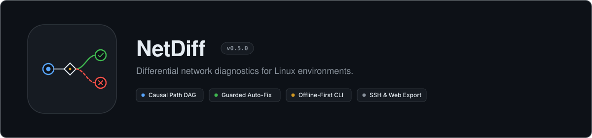

<p align="center">
  <picture>
    <source media="(prefers-color-scheme: dark)" srcset="assets/banner.svg">
    <source media="(prefers-color-scheme: light)" srcset="assets/banner.svg">
    
  </picture>
</p>

<p align="center">
  <a href="https://golang.org"></a>
  <a href="https://github.com/Ackintya/netdiff/actions"></a>
  <a href="https://aistudio.google.com"></a>
  
  
  
  <a href="LICENSE"></a>
</p>

<p align="center">
  <a href="https://ackintya.github.io/netdiff/"></a>
</p>

<p align="center">
  <strong>NetDiff explains why a network connection works in one environment and fails in another.</strong><br>
  Capture target-specific state into portable snapshots, model connections as a causal dependency graph, and pinpoint the earliest root-cause divergence in seconds.
</p>

---

## The Problem: "It worked on my machine... why does it fail in staging?"

Debugging intermittent network drops, misordered policy rules, missing container routes, or firewall timeouts across environments is frustrating:

| The Traditional Way | The NetDiff Way |
|---|---|
| Run 15 disjointed CLI commands (`ip route`, `ip rule`, `iptables`, `resolvectl`, `ss`, `ip link`, `arp`, `openssl`). | Run **one command**: `netdiff diagnose api.internal:443` or compare snapshots. |
| Get overwhelmed by hundreds of lines of configuration noise that have nothing to do with the failure. | NetDiff scopes queries **strictly to the target** and filters out ephemeral ports and index noise. |
| Guess which difference actually broke the connection. | Models the packet path as a **Causal DAG** and points directly to the earliest divergence. |
| Wonder how to safely fix the issue. | Generates an **Actionable Remediation Playbook** with copyable Bash, Netplan config, and verification. |
| Copy-paste raw configs into an LLM and risk hallucination. | Ask `netdiff ask "<question>"` grounded **strictly in verified kernel facts**. |

---

## 30-Second Quickstart

### 1. Single-Command Diagnosis (Baseline Workflow)
When your service is working, capture your baseline:
```bash
# Capture working baseline (saved automatically to ~/.netdiff/baselines/)
netdiff diagnose api.internal.corp:443
```
When something breaks later, run the exact same command to get an instant root-cause analysis:
```bash
netdiff diagnose api.internal.corp:443
```

### 2. Cross-Host Snapshot Comparison
Compare two environments (e.g. laptop vs staging container):
```bash
# Host A (working):
netdiff capture api.internal.corp:443 -o good.ndiff

# Host B (failing):
netdiff capture api.internal.corp:443 -o bad.ndiff

# Compare and render the causal dependency graph:
netdiff graph good.ndiff bad.ndiff
```

### 3. Frictionless Remote Triage via SSH (New in v0.5.0)
Triage remote staging or production servers without manual `scp` file transfers:
```bash
# Compare your local machine against remote staging host over SSH in ONE command:
netdiff compare api.internal.corp:443 --remote deploy@staging-host

# Or export an ultra-crisp dark-mode vector SVG card directly for Slack, Jira, or PRs:
netdiff graph good.ndiff bad.ndiff --export incident.svg
```

---

## Visual Terminal Previews

<p align="center">
  
</p>

### 1. Terminal Causal Dependency Graph (`netdiff graph`)
Visualizes the physical and logical packet journey, pointing straight to the root cause:

```text
=== NetDiff Causal Dependency Graph ===
Target: api.internal.company:443 (port: 443, proto: tcp)
Path:   [WORKING] DEVELOPER-LAPTOP-WORKING  vs  [FAILING] DEVELOPER-WORKSTATION-FAILING
Legend: ● Match   ✗ Divergent   ◄── Earliest Divergence (Root Cause)
──────────────────────────────────────────────────────────────────────────

● [1] Target Hostname        [MATCH] api.internal.company
  │
  ▼
● [2] DNS Resolution         [MATCH] 10.40.8.21
  │
  ▼
● [3] Destination IP         [MATCH] 10.40.8.21
  │
  ▼
✗ [4] Policy Routing (ip rule) [DIVERGENT] from all to 10.40.0.0/16 lookup 200 ≠ main ◄── ROOT CAUSE
  │  ├── ✗ Routing Table        table 200 (table 200) ≠ table 254 (main)
  │  ├── ● FIB Route Lookup     success (route found)
  │  ├── ✗ Egress Interface     tun0 ≠ eth0
  │  ├── ✗ Next-Hop Gateway     10.8.0.1 ≠ 192.168.1.1
  │  └── ✗ Source IP Selected   10.8.0.14 ≠ 192.168.1.84
  │
  ▼
● [5] Neighbor ARP/NDP       [MATCH] none
  │
  ▼
✗ [6] Interface MTU & Link   [DIVERGENT] 1420 bytes (oper: up) ≠ 1500 bytes (oper: up)
  │
  ▼
✗ [7] TCP Connection         [DIVERGENT] connected (27ms) ≠ timeout
  │
  ▼
● [8] TLS Handshake          [MATCH] not performed
──────────────────────────────────────────────────────────────────────────

Actionable Remediation Playbook:
  Immediate Fix:   $ sudo ip rule add to api.internal.company/32 lookup 200
  Verification:    $ ip rule show | grep 200
  Why:             Directs target traffic to table 200 via tun0 instead of fallback default eth0.
```

### 2. Conversational Q&A Grounded in Evidence (`netdiff ask`)
Ask debugging questions directly in the terminal without losing context:
```bash
$ netdiff ask good.ndiff bad.ndiff "Why is this connection timing out?"

  ╔══════════════════════════════════════════════════════════════════════╗
  ║  NETDIFF INVESTIGATION  ·  api.internal.company:443                  ║
  ╚══════════════════════════════════════════════════════════════════════╝

  Question: "Why is this connection timing out?"

  Evidence-Grounded Answer:
  Based on NetDiff snapshot comparison for api.internal.company:443:
  
  ● Root Cause (Earliest Divergence): Policy Rule: from all to 10.40.0.0/16 lookup 200 != default main
  ● Outcomes: Working=laptop (connected, 27ms), Failing=workstation (timeout)
  
  - [Policy] Failing host is missing the rule capturing traffic for 10.40.0.0/16 into table 200.
  - [Route] Traffic drops into table 254 (main) and egresses physical interface eth0 instead of tun0.
  - [Interface] Without the VPN tunnel encapsulation on tun0, intermediate routers drop the packet.
```

---

## Key Capabilities

### ⚡ 1. 100% Offline-First Engine with Optional Gemini AI
NetDiff operates **completely offline** with zero external API requirements. Its built-in deterministic causal DAG engine analyzes path differences and outputs complete remediation playbooks locally.

When you want generative AI synthesis:
```bash
# Save your free Gemini API key once:
netdiff auth AIzaSy...

# Check status:
netdiff config show
```
Once configured, NetDiff automatically activates Gemini reasoning across `explain`, `diagnose`, and `ask` with strict OpenAPI schema validation (`responseSchema`) to prevent hallucinations.

### 📊 2. Standalone Interactive HTML Reports
Generate zero-dependency, self-contained HTML reports for Slack, Jira, or post-mortems:
```bash
netdiff report good.ndiff bad.ndiff --html -o incident.html
```
* **Offline Capable**: All styles, icons, and comparison data are bundled into one file. Open it with any browser via `file://`.
* **Interactive Inspector**: Click any stage on the visual DAG to inspect kernel socket telemetry (`TCP_INFO`), TLS certificates, and causal rationales.
* **1-Click Copy**: Copy immediate Bash fixes directly to your clipboard.

### 🖥️ 3. Interactive Web Dashboard (`netdiff ui`)
Explore dual dependency DAGs side-by-side in your local browser:
```bash
netdiff ui good.ndiff bad.ndiff -p 8080
```

### 🔍 4. Kernel TCP Socket Telemetry (`TCP_INFO`)
Inspect socket internals that ping and traceroute miss:
* Microsecond kernel RTT and RTT variance
* Outbound packet retransmissions & total retransmits
* Congestion window (`snd_cwnd`)
* Path MTU (`pmtu`) discovery
* Lost and dropped packet counters

### 🛡️ 5. Guarded Automated Remediation (`netdiff fix`)
Safely apply verified remediation commands synthesized by the engine without risk:
```bash
# Preview what commands would run:
netdiff fix good.ndiff bad.ndiff --dry-run

# Execute with automated canary validation & rollback protection:
netdiff fix good.ndiff bad.ndiff --apply -y
```
* **Canary Probe**: Immediately dials the target endpoint after applying the fix.
* **Automatic Rollback**: If the canary probe does not recover connectivity, NetDiff **automatically executes the rollback command** and restores baseline state.

### ⏱️ 6. Proactive Baseline Drift Monitor (`netdiff watch`)
Continuously audit live target state against saved baseline snapshots before customer-facing outages occur:
```bash
# Audit target every 15 seconds:
netdiff watch api.internal.corp:443 --interval 15s

# Run single audit for CI/CD gates (exit code 0: healthy, 2: drift detected):
netdiff watch api.internal.corp:443 --once

# Stream line-delimited JSON (NDJSON) for SIEM / Datadog:
netdiff watch api.internal.corp:443 --json
```

---

## How It Works: The 8-Layer Causal Model

<p align="center">
  
</p>

NetDiff captures state strictly bounded to the target host and port, then models packet flow through the kernel's decision pipeline:

```text
Target (host:port)
       │
  Probe Planner
       │
 ┌─────┴───────────┬──────────────┐
 ▼                 ▼              ▼
DNS              Route           TCP
Collector      Collector        Probe
 │                 │              │
 └─────┬───────────┴──────────────┘
       ▼
 Portable Snapshot (.ndiff)
       │
 Snapshot Diff Engine
       │
 Evidence Dependency Graph (DAG)
       │
 Relevance Classification
       │
 ┌─────┴────────────────────────┐
 ▼                              ▼
Deterministic Engine        Gemini AI Engine
 │                              │
 └─────┬────────────────────────┘
       ▼
 Diagnostic Explanation & Remediation Playbook
       │
 ┌─────┴───────────┬──────────────┐
 ▼                 ▼              ▼
Terminal Graph   Web Dashboard  HTML Report
```

NetDiff evaluates divergence along the canonical dependency chain:
$$\text{Hostname} \rightarrow \text{DNS} \rightarrow \text{Dest IP} \rightarrow \text{Policy Rule} \rightarrow \text{Route Table} \rightarrow \text{Egress Link} \rightarrow \text{ARP/Neighbor} \rightarrow \text{MTU} \rightarrow \text{TCP} \rightarrow \text{TLS}$$

The **earliest divergent node** along this chain is identified as the root cause, filtering out downstream cascade symptoms.

---

## Diagnosed Failure Scenarios

NetDiff distinguishes between common real-world networking problems:

| Scenario | Observed Symptom | NetDiff Root Cause Finding | Actionable Remediation |
|---|---|---|---|
| **Missing Policy Rule** | TCP timeout / routing loop | Earliest divergence at Policy Rule (`ip rule`) | `sudo ip rule add to <ip>/32 lookup <table_id>` |
| **Missing Route** | `RTNETLINK: Network is unreachable` | Route lookup failure while interface is UP | `sudo ip route add <dest>/32 dev <iface> via <gw>` |
| **Interface Down** | Link administratively disabled | Interface state DOWN on required egress path | `sudo ip link set dev <iface> up` |
| **Firewall Drop** | TCP timeout; routes functional | Active packet filter (`iptables`/`nftables`) DROP rule | `sudo iptables -D OUTPUT -p tcp --dport <port> -j DROP` |
| **Neighbor ARP Failure** | TCP timeout; route UP | Layer 2 ARP state `INCOMPLETE` / `FAILED` | `sudo ip neigh replace <ip> lladdr <mac> dev <iface>` |
| **TLS Certificate Error** | TCP connects; TLS handshake fails | Untrusted CA root or expired certificate | `sudo cp <ca.crt> /usr/local/share/ca-certificates/` |
| **Port Closed / Service Down** | TCP RST (`ECONNREFUSED`) | Full bidirectional reachability confirmed; daemon down | `sudo systemctl status <service>` |

---

## CLI Command Reference

| Command | Description |
|---|---|
| `netdiff diagnose <target>` | Single-command diagnosis comparing against saved baseline |
| `netdiff check <target>` | Fast reachability probe with one-line status summary |
| `netdiff capture <target> [-o file] [--remote host]` | Capture target network state locally or remotely via SSH |
| `netdiff compare <good> <bad> [--remote host] [--export file]` | Compare snapshots and rank causal path differences |
| `netdiff graph <good> <bad> [--remote host] [--export file.svg]` | Render terminal ASCII tree or export publication-ready vector SVG |
| `netdiff explain <good> <bad> [--no-ai]` | Synthesize diagnostic explanation and remediation playbook |
| `netdiff ask <good> <bad> "<question>"` | Ask conversational debugging questions grounded in snapshot evidence |
| `netdiff fix <good> <bad> [--apply]` | Guarded automated remediation with canary probe & rollback protection |
| `netdiff watch <target> [--interval 30s]` | Proactive baseline drift monitor auditing network state continuously |
| `netdiff report <good> <bad> [-o file.svg\|file.html]` | Generate Markdown, interactive HTML, or vector SVG incident report |
| `netdiff ui <good> <bad> [-p 8080]` | Launch interactive browser visualizer comparing dual dependency DAGs |
| `netdiff auth [key]` | Configure Gemini API key for AI reasoning and diagnosis |
| `netdiff config <show\|set-key\|clear>` | Manage persistent NetDiff configuration (`~/.netdiff/config.json`) |
| `netdiff probe <name> [param] [-t target]` | Execute a bounded diagnostic validation probe |
| `netdiff version` | Display version information |

---

## Reproducible Testing Laboratory (`scripts/lab/`)

NetDiff includes an automated, isolated Linux network namespace laboratory (`nd-client` and `nd-server` connected via `veth` pairs) that reproduces common failures without touching host interfaces:

```bash
# Run all failure scenarios end-to-end:
sudo ./scripts/lab/lab.sh run-all

# Or run individual steps:
sudo ./scripts/lab/lab.sh setup              # Create namespaces & mock services
sudo ./scripts/lab/lab.sh baseline           # Record baseline good.ndiff
sudo ./scripts/lab/lab.sh inject iface-down  # Inject a fault
sudo ./scripts/lab/lab.sh capture bad        # Capture failing snapshot bad.ndiff
sudo ./scripts/lab/lab.sh verify iface-down  # Run NetDiff and verify diagnosis
sudo ./scripts/lab/lab.sh cleanup            # Clean up namespaces
```

---

## Installation & Building

```bash
# Clone the repository:
git clone https://github.com/Ackintya/netdiff.git
cd netdiff

# Build local binary:
go build -o netdiff ./cmd/netdiff

# Run all unit tests:
go test -v ./...
```

---

## Community & LinkedIn Launch

Presenting or sharing NetDiff with your engineering team or network? Check out [`assets/LINKEDIN_LAUNCH.md`](assets/LINKEDIN_LAUNCH.md) for viral post templates, a 7-slide carousel deck, and high-resolution architecture graphics.

---

<p align="center">
  <sub>Built with care for network engineers, SREs, and systems developers. MIT Licensed.</sub>
</p>
