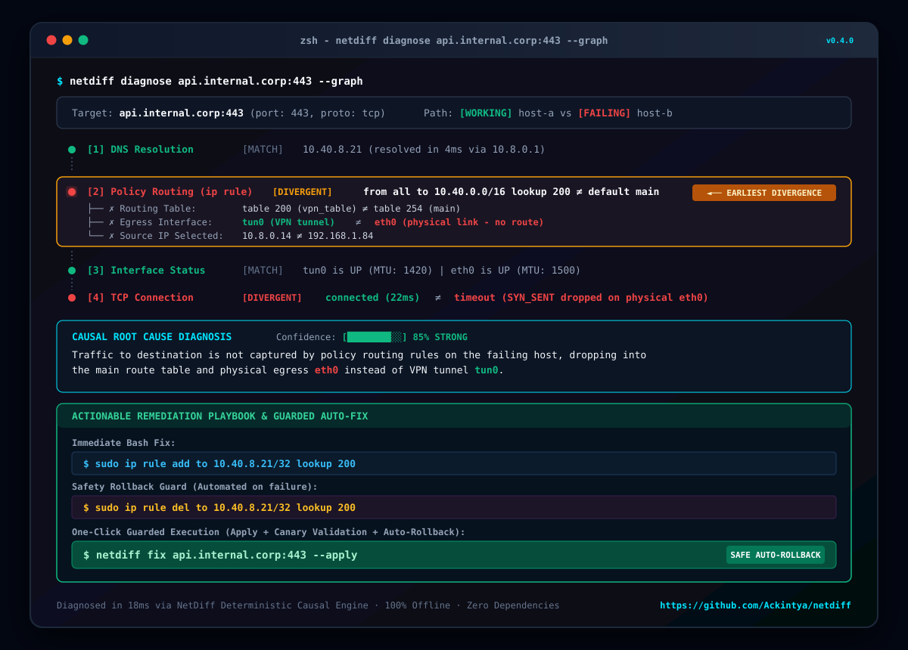

<p align="center">
  
</p>

<p align="center">
  <a href="https://golang.org"></a>
  <a href="https://github.com/Ackintya/netdiff/actions"></a>
  <a href="https://ackintya.github.io/netdiff/"></a>
  <a href="LICENSE"></a>
</p>

<p align="center">
  <strong>Explain why a network connection works in one environment and fails in another.</strong><br>
  Capture target-scoped Linux network state, isolate the earliest root-cause divergence along the causal path, and generate verified fixes.
</p>

---

## Quickstart

```bash
# 1. Single-host baseline diagnosis (captures baseline first time, diffs on subsequent runs)
netdiff diagnose api.internal.corp:443

# 2. Remote differential over SSH (no manual scp required)
netdiff compare api.internal.corp:443 --remote deploy@staging-host

# 3. Export a clean vector diagram or interactive HTML report
netdiff graph good.ndiff bad.ndiff --export incident.svg
```

> **Interactive Browser Playground:** Explore real failure scenarios or drop your own `.ndiff` files directly in the browser at **[ackintya.github.io/netdiff](https://ackintya.github.io/netdiff/)**.

---

## Explore Capabilities

<details>
<summary><strong>Visual Walkthrough: Terminal Causal Graph &amp; Stack Architecture</strong></summary>

<br>

NetDiff evaluates divergence in causal kernel order—$\text{Hostname} \rightarrow \text{DNS} \rightarrow \text{IP} \rightarrow \text{Policy Rule} \rightarrow \text{Route Table} \rightarrow \text{Interface} \rightarrow \text{ARP} \rightarrow \text{Firewall} \rightarrow \text{TCP} \rightarrow \text{TLS}$—and pins the earliest divergence instead of downstream timeouts.

<p align="center">
  
</p>

<p align="center">
  
</p>

</details>

<details>
<summary><strong>Key Features: AI Q&amp;A, Guarded Auto-Fix &amp; Drift Monitor</strong></summary>

- **100% Offline-First + Optional Gemini AI**: Core differential analysis, remediation generation, and Q&A work offline. Save an optional API key with `netdiff auth <key>` for open-ended schema-grounded synthesis.
- **Conversational Q&A (`netdiff ask`)**: Ask `netdiff ask good.ndiff bad.ndiff "Why is this timing out?"` grounded strictly in captured snapshot evidence.
- **Guarded Automated Fix (`netdiff fix`)**: Preview (`--dry-run`) or apply (`--apply`) verified bash remediations with immediate canary dial checks and automatic rollback if connectivity does not recover.
- **Proactive Drift Auditor (`netdiff watch`)**: Periodically compare live targets against saved baselines with exit code `2` on drift and `--json` NDJSON streams for monitoring pipelines.
- **Interactive Local UI (`netdiff ui`)**: Clean light/dark browser inspector for diffing snapshots and viewing kernel `TCP_INFO` counters and TLS certificates.

</details>

<details>
<summary><strong>Diagnosed Failure Modes &amp; Remediations</strong></summary>

| Failure Mode | Earliest Divergence | Synthesized Remediation |
|---|---|---|
| **Missing Policy Rule** | Policy rule (`ip rule`) | `sudo ip rule add to <ip>/32 lookup <table>` |
| **Missing Route** | Route lookup failure | `sudo ip route add <dest>/32 dev <iface> via <gw>` |
| **Interface Down** | Link `oper_state: down` | `sudo ip link set dev <iface> up` |
| **Firewall Drop** | Active packet filter | `sudo iptables -D OUTPUT -p tcp --dport <port> -j DROP` |
| **Neighbor ARP Failure** | `INCOMPLETE` / `FAILED` | `sudo ip neigh replace <ip> lladdr <mac> dev <iface>` |
| **TLS Certificate Error** | Untrusted CA / expired | `sudo cp <ca.crt> /usr/local/share/ca-certificates/` |
| **Closed Port / Daemon Down** | TCP `ECONNREFUSED` | `sudo systemctl status <service>` |

</details>

<details>
<summary><strong>CLI Reference &amp; Reproducible Namespace Lab</strong></summary>

| Command | Purpose |
|---|---|
| `netdiff diagnose <target>` | Diagnose target against local baseline |
| `netdiff check <target>` | Fast single-line reachability check |
| `netdiff capture <target> [-o file] [--remote host]` | Capture target state locally or via SSH |
| `netdiff compare <good> <bad> [--remote host] [--export file]` | Diff snapshots and rank causal path differences |
| `netdiff graph <good> <bad> [--export file.svg]` | Render causal tree or export vector SVG |
| `netdiff explain <good> <bad>` | Generate diagnostic summary and fix playbook |
| `netdiff ask <good> <bad> "<question>"` | Evidence-grounded Q&A |
| `netdiff fix <target> [--dry-run\|--apply]` | Guarded remediation with canary rollback |
| `netdiff watch <target> [--interval 30s] [--once]` | Continuous baseline drift check |
| `netdiff report <good> <bad> [-o file.html\|file.svg]` | Export Markdown, HTML, or SVG report |
| `netdiff ui <good> <bad> [-p 8080]` | Launch local web explorer |
| `netdiff auth [key]` / `netdiff config` | Manage optional Gemini API credentials |

**Linux Namespace Lab (`scripts/lab/lab.sh`)**
```bash
sudo ./scripts/lab/lab.sh run-all
```

</details>

---

## Install & Test

```bash
git clone https://github.com/Ackintya/netdiff.git
cd netdiff
go build -o netdiff ./cmd/netdiff
go test -v ./...
```

---

<p align="center">
  <sub>MIT Licensed · <a href="assets/LINKEDIN_LAUNCH.md">Launch Playbook &amp; Media Assets</a></sub>
</p>
